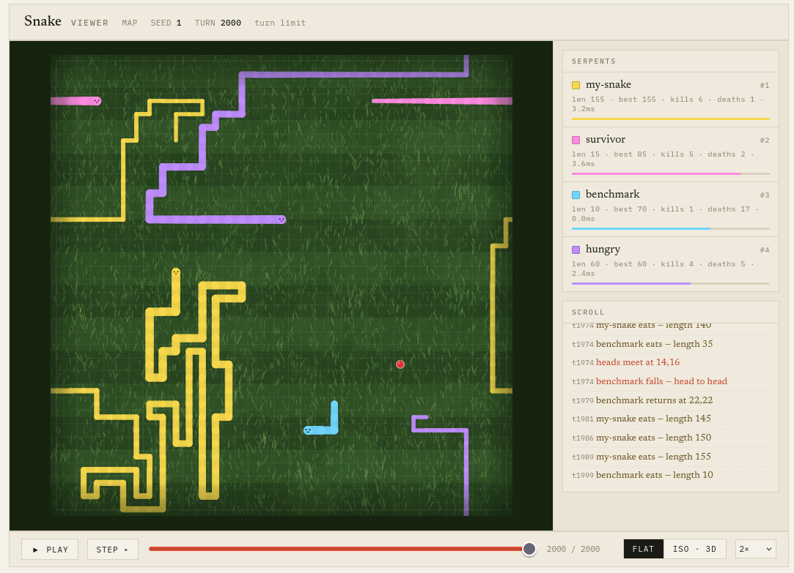

# Competitive Snake Assignment
This repository contains my submission to the 2026 Wits Snake AI competition. This competition entails coding an algorithm that can competitively play Snake competitively, ranked by the longest length reached.

Further information about the competition and its protocol is available under `snake-platform/docs`.

# Running the snake
- Use the script `run-platform.sh` to launch the provided snake platform and allow the snake to play on it. It will be labelled `my-snake`
- Use the script `test-snake.sh {FROMSEED} {TOSEED}` to simulate the game repeatedly for the range of game seeds FROMSEED-TOSEED and print out the stats.

# Repository structure
This repository contains both the code for my agent (in the `/src/` folder), as well as the platform provided by the lecturer under `/snake-platform/`, including the web interface, backend simulation platform, and the provided practice snakes.